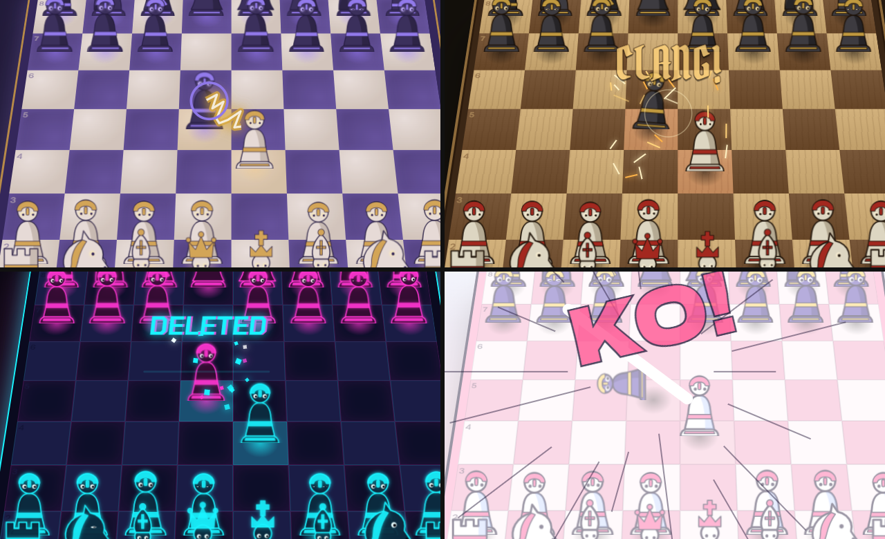
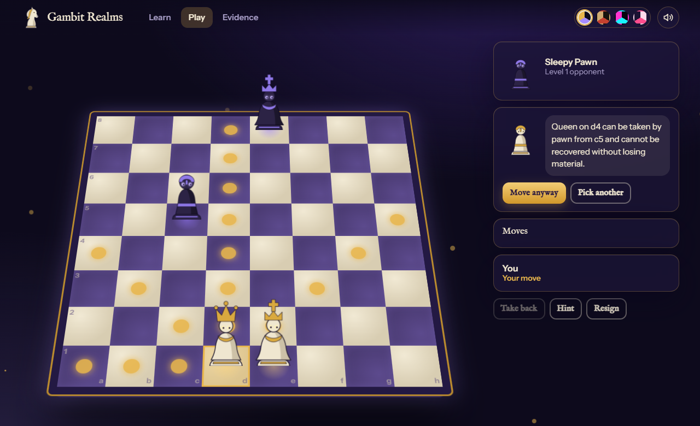
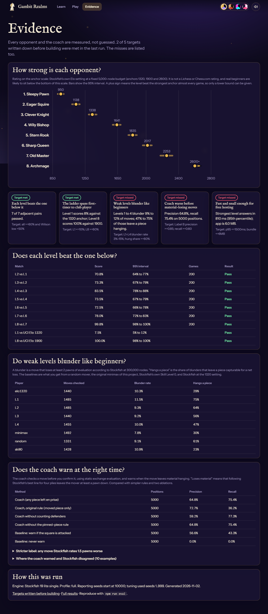
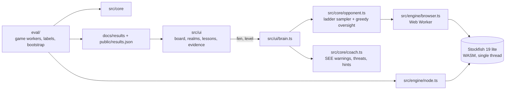

# Gambit Realms

Chess where every capture is a duel. Four animated realms, eight opponents whose strength was measured, and a coach that warns you before you give a piece away. It runs in your browser and costs nothing.

**Play it: @@LIVE_URL@@**



## The problem

A first-time player drops out of chess for two reasons that free tools handle badly.

1. **The opponent is the wrong shape.** A full-strength engine crushes silently. A random mover is dull. Engine "skill levels" make mistakes no beginner would make, or never err at all.
2. **Nothing explains a mistake when it happens.** Post-game analysis arrives after the learner has stopped caring.

The question this repo answers with measurements: *can a small in-browser engine layer give a ladder of opponents from first-timer to club player, whose mistakes look like a beginner's, plus a coach that warns before a move that loses material?*

## Evidence that the problem is real

The baselines come from the same harness as the solution, on games the solution never saw ([results](docs/results/RESULTS.md)).

| Opponent | Level 1 scores against it | Moves that blunder | Of those, hang a piece |
|---|---:|---:|---:|
| Random mover | about 90% | 9.1% | 61% |
| This project's original minimax (depth 2, material only) | about 49% | 7.8% | 30% |
| Stockfish "Skill Level 0" | about 11% | 10.9% | 23% |
| Stockfish at its weakest "UCI Elo" setting (1320) | about 12% | 10.3% | 29% |
| **Level 1 (this project)** | n/a | 11.5% | 75% |

What the table says: the weakest setting Stockfish offers beats this project's Level 1 about nine games in ten, so a first-timer loses to it. Its errors are also not a beginner's: only a quarter of its blunders leave a piece hanging. A random mover hangs pieces but is beaten nine games in ten, and plays nonsense. The original minimax sits in between with no strength dial. (Scores are from games on seeds from 10,000 up; a blunder is a move that loses at least two pawns by Stockfish's own evaluation at 300,000 nodes.)

This project began as a 220-line pygame app (`main.py`, still in the git history). Its AI was a material-only minimax of depth 2. It is kept as the "minimax" baseline above.

## The approach

**Opponent ladder** (`src/core/ladder.ts`). Each of eight levels is `nodes`, `multipv`, `temperature` and `oversight`. Stockfish 19 (the 1.8 MB WebAssembly build) searches a few nodes and returns its top candidate moves. The level samples one with weight `exp(-loss/temperature)`. With probability `oversight` the level instead plays a *greedy* move: the biggest capture in reach, ignoring the reply. That second ingredient is what makes a beginner's mistake look like a beginner's: it hangs pieces.

**Coach** (`src/core/see.ts`, `src/core/coach.ts`). Static exchange evaluation on top of chess.js, with pins, en passant and promotion. Before you confirm a move it warns if the move leaves any of your pieces to be taken for free. It also glows pieces that are already en prise and explains a hint in words. No engine call is needed for the warning.



**Academy** (`src/ui/lessons.ts`). Eight short interactive lessons, from "what is e4" to checkmate, castling and spotting a hanging piece. A unit test checks that every position loads and every accepted move is legal.

**Four realms** (`src/ui/capture.ts`). One SVG piece rig re-skinned through CSS variables, plus a different fight in each world: a spell bolt and a stone shatter, a sword clash and a topple in dust, a laser slice and a glitch delete, a hit-stop and a launch into the sky. Pieces hop, lean and turn to face where they go; knights leap.

**Evidence page** (`#/evidence`). The numbers you are reading here are loaded from `results.json`, so the product shows exactly what the repo measured.



## What I wrote down before building

`docs/DESIGN.md` fixed five targets and the method before any solution code. Changes to it are logged as amendments, with the reason, before the reporting run.

Full run: 3,560 games, seeds from 10,000 up (the level parameters were tuned on seeds 1 to 999 only), Stockfish 19 lite as the opponent engine and as the 300,000-node referee.

| Target (written down first) | Result | Met |
|---|---|:---:|
| M1: every level beats the one below, score at least 60% and 95% interval above 50%, 200 games each | 7 of 7 pairs: 70.8%, 73.3%, 83.5%, 73.5%, 72.5%, 78.0%, 99.8% | yes |
| M2: Level 1 scores at most 10% against Stockfish 1320; Level 8 at least 60% against 1900 | 7.5% (95% interval 4.6 to 12.0) and 100% | yes |
| M3: Levels 1 to 4 blunder on 3% to 15% of moves, and at least 60% of blunders hang a piece | Blunder rate 9.2% to 11.5% (met). Hang share 74.9%, 64.5%, 56.4%, 46.9% | **no** (Levels 3 and 4) |
| M4: coach precision at least 0.85 and recall at least 0.60 on 5,000 positions | Precision 64.8%, recall 75.4% | **no** (precision) |
| M5: strongest level answers in 1.5 s or less (95th percentile) and the app is 6 MB or less | 1,283 ms (measured while the machine was busy; 650 to 810 ms when idle) and 2.5 MB | yes |

Measured strength of the eight opponents, on Stockfish's own Elo scale at a fixed 5,000-node budget (anchors 1320, 1900, 2600; 95% bootstrap intervals). This is **not** a Lichess or Chess.com rating.

| Level | Name | Rating | 95% interval |
|---|---|---:|---:|
| 1 | Sleepy Pawn | 950 | 912 to 986 |
| 2 | Eager Squire | 1138 | 1089 to 1183 |
| 3 | Clever Knight | 1338 | 1294 to 1391 |
| 4 | Wily Bishop | 1641 | 1589 to 1687 |
| 5 | Stern Rook | 1835 | 1782 to 1886 |
| 6 | Sharp Queen | 2017 | 1959 to 2070 |
| 7 | Old Master | 2253 | 2177 to 2325 |
| 8 | Archmage | at least 2600 | beat the strongest anchor in 98.75% of games, so no upper bound |

The coach against its baselines (label: following Stockfish's best line for four plies leaves the mover at least a pawn down):

| Method | Precision | Recall |
|---|---:|---:|
| **Coach: warns if any piece is left hanging** | 64.8% | 75.4% |
| Coach, original rule (moved piece only) | 72.7% | 36.2% |
| Coach without counting defenders | 59.2% | 77.3% |
| Baseline: warn if the destination square is attacked | 56.6% | 43.3% |
| Baseline: never warn | 0% | 0% |

So the coach catches three in four material-losing moves, about 1.7 times what the "is the square attacked" rule catches, at the cost of about one warning in three being a false alarm. Players can always press "Move anyway".

## What did not work

- **Two of five targets were missed.** Levels 3 and 4 blunder at a beginner's rate but only 56% and 47% of those blunders hang a piece, because those two levels use a small oversight weight (0.10 and 0.05), so most of their errors are the engine-noise kind, not hung pieces. The coach's precision is 65% against a target of 85%. A study on tuning games (`docs/results/coach-tuning.json`) found no net-loss threshold that reaches both precision and recall, so I kept the more sensitive version.
- **Where the coach is wrong.** A false alarm is a position where static exchange says a piece can be taken for free but Stockfish's best line does not lose material within four plies, for reasons a single-exchange rule cannot see. Of the ten missed warnings listed in the results, nine are endgame pawn-promotion races, which the material label counts but a hanging-piece rule cannot see. Ten examples of each kind are in `docs/results/RESULTS.md`.
- **The first harness was wrong, and the first numbers with it.** The initial run reported that Stockfish "aborts at 300,000 nodes". The cause was my adapter issuing commands from inside the engine's own output callback, which the single-thread WebAssembly build cannot take. Other defects found by review: games ran one at a time, rating intervals were fabricated as plus or minus 60, and the coach label reused the coach's own logic. All were fixed before the reporting run and are logged in `docs/DESIGN.md`.
- **Engine-only errors are the wrong shape.** In early runs, softmax noise over Stockfish's top moves gave plausible-looking blunders but only 15 to 19% of them hung a piece (target 60%), and the weakest level never got below the 1320 anchor. The greedy "oversight" move was added for that reason (amendment 3).
- **The bundle check failed at first** (6.02 MB, over the 6 MB target) because the font packages ship every script. Latin-only imports brought the app down to about 2.5 MB.
- **Ratings above 2600 cannot be measured** with Stockfish's own anchor scale; Level 8 is reported as a lower bound.
- **A realm cross-fade swallowed clicks** in a slow browser until I capped it at 800 ms. The end-to-end test in CI found it.

## Limits

- The anchor scale is Stockfish's own Elo setting at a fixed node budget. It is not a Lichess, Chess.com or FIDE rating, and the mapping to human ratings is unvalidated. Real beginners are probably weaker than the bottom of this scale.
- "Beginner-like" mistakes are a model (greedy grabbing plus softmax noise), checked against an engine's idea of a blunder, not against human games.
- Stockfish at 300,000 nodes is the ground truth. Its own errors become label noise.
- On a slow phone the strongest opponent will think longer than the figure measured in Node.
- Everything is client-side. Progress is kept in `localStorage`; there are no accounts and no server.

## Architecture



`src/core` has no DOM and no engine dependency, so the same code runs in the browser, in the unit tests and in the evaluation harness.

## Run it

```bash
npm install          # also copies the Stockfish WASM into public/engine
npm run dev          # http://localhost:5173
npm test             # unit tests (core, coach, lessons, stats, harness)
npm run e2e -- http://localhost:5173/   # plays a real game in a browser (needs Chrome, Edge or `npx playwright-core install chromium`)
npm run a11y         # axe-core audit of every route in every realm
```

Reproduce the numbers:

```bash
npm run eval:quick   # about 15 minutes, 12 games per pairing
npm run eval         # the full profile used in this README (around two hours on 16 cores)
npm run eval:calibrate -- --region low   # the tuning-seed sweeps behind the level parameters
```

Results are regenerated into `docs/results/` and `public/results.json`. Games are cached in `eval/out/` so an interrupted run resumes.

## Deploy and free-tier limits

GitHub Pages serves the static build (`.github/workflows/deploy.yml`). There is no server, no database and no account, so there is no cold start. The first move downloads the 1.8 MB engine once. Limits: GitHub Pages allows a 1 GB site and soft bandwidth of 100 GB a month, and only serves public repositories on the free plan.

## Credits and licences

- Code: GPL-3.0-only (see `LICENSE`), because it bundles [Stockfish.js](https://github.com/nmrugg/stockfish.js) (GPL-3.0, Stockfish 19).
- Rules: [chess.js](https://github.com/jhlywa/chess.js) (BSD-2-Clause).
- Fonts, self-hosted through Fontsource under the SIL Open Font Licence: IM Fell English, Pirata One, Chakra Petch, Dela Gothic One, Instrument Sans.
- The home-page demo replays Morphy's Opera Game (1858), a public-domain game.
